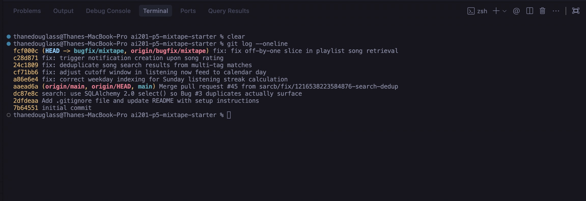

# Project 5: Mixtape Bug Hunt — Submission

## AI Usage

This project utilized AI assistance (Antigravity AI coding assistant) throughout the debugging, development, and documentation lifecycle in accordance with the project guidelines:

1. **Codebase Navigation & Architecture Analysis**:
   - Automated structural inspection of application entrypoints (`app.py`), relational models (`models.py`), presentation layers (`routes/`), and business logic (`services/`).
   - Mapped relationships across database models (`User`, `Song`, `Tag`, `Playlist`, `Notification`, `ListeningEvent`, `Rating`) and traced request-response lifecycles.

2. **Root Cause Analysis & Diagnosis**:
   - Analyzed unit test failures in `pytest` to pinpoint exact lines of failure.
   - Evaluated temporal boundary conditions in Python `datetime` (UTC conversions, weekday indexing, rolling windows vs. calendar day cutoffs).
   - Inspected SQLAlchemy 2.0 query patterns, specifically Cartesian product anomalies produced by unconstrained joins across many-to-many relationship tables.
   - Identified missing service layer interactions and off-by-one list slicing boundaries.

3. **Test Construction & Regression Verification**:
   - Formulated isolated unit and regression test cases within the pytest framework to reliably trigger reported defects, verify fixes, and protect against regressions.
   - Verified that all edge cases (empty states, boundary conditions, self-actions) behave consistently.

4. **Documentation & Version Control**:
   - Structured comprehensive Root Cause Analyses covering reproduction, diagnosis, precise code citations, targeted modifications, and side-effect verifications.
   - Maintained strict commit discipline following conventional commit specifications for each isolated fix.

---

## Codebase Map

### Architecture Overview

The Mixtape application is built as a modular Flask web application structured into distinct layers following separation of concerns:
- **Application Factory & Database Initializer (`app.py`)**: Initializes Flask, configures SQLite via Flask-SQLAlchemy, and registers Blueprints with URL prefixes.
- **Data Models (`models.py`)**: Declares SQLAlchemy ORM models and association tables representing domain entities.
- **Route Handlers (`routes/`)**: Handles HTTP requests, parses parameters, performs input validation, delegates business logic to services, and serializes JSON responses.
- **Service Layer (`services/`)**: Encapsulates core business logic, database queries, state mutations, and domain rules.

```
ai201-project5-mixtape-starter/
├── app.py                      # Flask application factory & database setup
├── models.py                   # SQLAlchemy models & association tables
├── routes/
│   ├── feed.py                 # Listening activity & feed endpoints
│   ├── playlists.py            # Playlist management endpoints
│   ├── songs.py                # Song details, ratings, & search endpoints
│   └── users.py                # User profiles, streaks, & notifications endpoints
├── services/
│   ├── feed_service.py         # Activity feed & friend listening queries
│   ├── notification_service.py # Event notification & rating workflows
│   ├── playlist_service.py     # Playlist creation & song retrieval logic
│   ├── search_service.py       # Song search & tag querying
│   └── streak_service.py       # Consecutive day listening streak tracking
└── tests/                      # Automated test suite
```

### Key Models and Relationships (`models.py`)

1. **`User`**: Represents registered listeners. Tracks profile information (`username`, `email`), listening stats (`listening_streak`, `last_listened_at`), and timestamp metadata. Contains relationships to shared songs, ratings, listening events, notifications, playlists, and a self-referential many-to-many `friends` relationship via the `friendships` association table.
2. **`Song`**: Represents shared tracks (`title`, `artist`, `album`, `genre`, `shared_by`, `share_note`). Connects to `Tag` entities via the `song_tags` association table and links to ratings and listening events.
3. **`Playlist`**: Represents curated collections of songs (`name`, `created_by`, `is_collaborative`). Uses the `playlist_entries` association table which tracks song order via an explicit `position` column.
4. **`Notification`**: Represents user notifications (`user_id`, `notification_type`, `body`, `read`, `created_at`) alerting users to social interactions.
5. **`ListeningEvent`**: Represents discrete song playback occurrences (`user_id`, `song_id`, `listened_at`) used for feeds and streak tracking.
6. **`Rating`**: Captures user ratings (1 to 5 stars) per song with a unique constraint on `(user_id, song_id)`.

### Feature Data Flow Trace: Adding a Song to a Collaborative Playlist

To illustrate the interaction between routes, services, and models, consider the flow when a user adds a song to an existing playlist:

1. **HTTP Request**: The client sends `POST /playlists/<playlist_id>/songs` with a JSON payload containing `{"song_id": "<song-uuid>", "added_by": "<user-uuid>"}`.
2. **Routing & Input Validation (`routes/playlists.py:add_song`)**:
   - The route handler retrieves `playlist_id` from the URL parameters and parses `song_id` and `added_by` from `request.get_json()`.
   - If required fields are missing, returns an HTTP 400 Bad Request error.
   - Forwards execution to `services/notification_service.py:add_to_playlist`.
3. **Domain Logic & Entity Lookup (`services/notification_service.py:add_to_playlist`)**:
   - Validates entity existence by retrieving the `Song`, `User`, and `Playlist` records from `db.session`.
   - Appends `song` to `playlist.songs` if not already present.
   - Commits the transaction to persist the new playlist entry in `playlist_entries`.
4. **Notification Trigger**:
   - Compares the song's original sharer (`song.shared_by`) with the adder's ID (`added_by`).
   - If a different user added the song, creates a new `Notification` entity (`notification_type="song_added_to_playlist"`) addressed to the song sharer with a message formatted with the actor and playlist details.
   - Persists the notification via `create_notification()`.
5. **Response Serialization**:
   - The route handler catches any domain exceptions (`ValueError`), formatting them into appropriate HTTP status codes (HTTP 400 or 404).
   - Upon successful execution, returns HTTP 201 Created with JSON payload `{"message": "Song added to playlist"}`.

### Architectural Patterns

- **Route-Service Separation**: Route functions only orchestrate HTTP parsing, validation, status code mapping, and response serialization. All data querying, relational manipulation, and business rules reside in `services/`.
- **Stateless Database Transactions**: Services interact directly with `app.db.session`, executing scoped queries and committing state changes atomically.
- **Normalized Relational Associations**: Cross-cutting relationships (`friendships`, `song_tags`, `playlist_entries`) use dedicated association tables, decoupling entity definitions and supporting auxiliary attributes (e.g., ordering `position` on playlist entries).

---

## Bug Fixes & Root Cause Analyses

### Issue #1 — My listening streak keeps resetting

- **1. How you reproduced it**:
  Executed `pytest tests/test_streaks.py::test_streak_increments_on_sunday`. The test simulates a user listening on Saturday (`2024-06-15`, `weekday() == 5`) and then listening on Sunday (`2024-06-16`, `weekday() == 6`). The test failed with `AssertionError: assert 1 == 2`, observing that `user.listening_streak` remained `1` instead of incrementing to `2`.

- **2. How you found the root cause**:
  Inspected `services/streak_service.py` within the `update_listening_streak()` function (lines 42–80). Traced the conditional branches that compute `days_since_last = (today - last_date).days` and evaluate whether to increment the streak or reset it.

- **3. The root cause**:
  In `services/streak_service.py`, line 73:
  ```python
  elif days_since_last == 1 and today.weekday() != 6:
      user.listening_streak += 1
  else:
      user.listening_streak = 1
  ```
  Python's `datetime.weekday()` standard designates Monday as `0` through Sunday as `6`. Line 73 explicitly included `and today.weekday() != 6`. Consequently, whenever `today` was Sunday (`weekday() == 6`), this branch evaluated to `False` even though `days_since_last == 1`. The flow dropped into the `else:` branch, resetting `user.listening_streak` back to `1`.

- **4. Your fix**:
  In `services/streak_service.py`, removed the invalid `and today.weekday() != 6` constraint from line 73. Consecutive day listening now consistently increments `user.listening_streak += 1` regardless of which day of the week it is, properly satisfying the domain rule that listening on consecutive calendar days increments streaks.

- **5. Your side-effect check**:
  - Verified same-day listening (`days_since_last == 0`) does not alter the streak.
  - Verified skipped days (`days_since_last > 1`) still reset the streak to 1.
  - Verified first-time listeners (`user.last_listened_at is None`) initialize streak to 1.
  - Added regression test `test_streak_continues_through_full_weekend_into_monday` to `tests/test_streaks.py` to ensure a multi-day streak traversing Friday through Monday increments steadily from 1 to 4 without boundary interruptions.
  - All 6 tests in `tests/test_streaks.py` passed.

### Issue #2 — Friends Listening Now shows people from yesterday

- **1. How you reproduced it**:
  Created a test suite in `tests/test_feed.py` (`test_listening_now_excludes_yesterday`). Seeded two friends: one whose last listen occurred late yesterday evening (23:00 UTC, within a 24-hour window from the current morning) and one whose last listen occurred earlier today. Invoking `get_friends_listening_now(user.id)` returned `['earlybird', 'nightowl']`, failing `assert 'nightowl' not in friend_names` with `AssertionError: assert 'nightowl' not in ['earlybird', 'nightowl']`.

- **2. How you found the root cause**:
  Inspected `services/feed_service.py` where `get_friends_listening_now()` computes the query cutoff filter (lines 13–35). Compared the implementation with the expected calendar day behavior described in the issue specification.

- **3. The root cause**:
  In `services/feed_service.py`, lines 13 and 32:
  ```python
  RECENT_THRESHOLD = timedelta(hours=24)
  ...
  cutoff = datetime.now(timezone.utc) - RECENT_THRESHOLD
  ```
  The filter computed `cutoff` as a rolling 24-hour interval (`now - timedelta(hours=24)`) instead of bounding it to the current calendar day. Friends who listened late yesterday evening were within 24 hours of the current morning, so their `listened_at >= cutoff` evaluated to `True`, causing them to erroneously appear in today's "Listening Now" feed.

- **4. Your fix**:
  In `services/feed_service.py`, updated `get_friends_listening_now(user_id: str, now: datetime | None = None)` to compute `cutoff` at the start of the current calendar day (midnight 00:00:00 UTC):
  ```python
  if now is None:
      now = datetime.now(timezone.utc)
  cutoff = now.replace(hour=0, minute=0, second=0, microsecond=0)
  ```
  This guarantees that only listening events occurring on the current calendar day are retrieved, while cleanly supporting deterministic time injection in tests.

- **5. Your side-effect check**:
  - Verified exact midnight boundary condition: events at 23:59:59 yesterday are excluded, while events at 00:00:00 today are included.
  - Verified per-friend deduplication remains intact: when a friend listens to multiple tracks today, only their most recent track is returned.
  - Verified `get_activity_feed()` remains unaffected and continues to return events spanning multiple days up to the requested limit.
  - Verified graceful handling for users with no friends (`[]`) and non-existent users (`ValueError`).
  - Added full test suite in `tests/test_feed.py` covering all scenarios (4 tests passing).

### Issue #3 — The same song keeps showing up twice in search

- **1. How you reproduced it**:
  Executed `pytest tests/test_search.py::test_search_no_duplicates_multi_tag_song`. The test searches for `"Crown Heights"`, which matches the track `"Crown Heights Anthem"`. Because this track is linked to three separate tags (`"rap"`, `"hip-hop"`, `"boom bap"`), the search query returned three identical entries for the song. The test failed with `AssertionError: assert 3 == 1`.

- **2. How you found the root cause**:
  Inspected `services/search_service.py` in the `search_songs()` function (lines 27–42). Examined the SQLAlchemy 2.0 query construction:
  ```python
  select(Song)
  .outerjoin(song_tags, Song.id == song_tags.c.song_id)
  .filter(...)
  ```
  Analyzed how outer joining on a many-to-many association table (`song_tags`) affects result row counts when `.scalars().all()` is invoked without deduplication.

- **3. The root cause**:
  In `services/search_service.py`, lines 28–40:
  ```python
  results = (
      db.session.execute(
          select(Song)
          .outerjoin(song_tags, Song.id == song_tags.c.song_id)
          .filter(
              db.or_(
                  Song.title.ilike(f"%{query}%"),
                  Song.artist.ilike(f"%{query}%"),
              )
          )
      )
      .scalars()
      .all()
  )
  ```
  The query explicitly joins `Song` with the `song_tags` association table without invoking `.distinct()`. In relational databases, joining a parent table (`song`) to a junction table (`song_tags`) produces a Cartesian row for every matching junction entry. If a song has $k$ tags, the SQL query generates $k$ result rows. When SQLAlchemy scalarizes and collects those rows into a list via `.scalars().all()`, the identical `Song` instance is returned $k$ times.

- **4. Your fix**:
  In `services/search_service.py`, appended `.distinct()` to the `select(Song)` query before executing:
  ```python
  select(Song)
  .outerjoin(song_tags, Song.id == song_tags.c.song_id)
  .filter(...)
  .distinct()
  ```
  This instructs SQLAlchemy and SQLite to issue a `SELECT DISTINCT` statement, eliminating duplicate song entity occurrences in the scalar results.

- **5. Your side-effect check**:
  - Verified single-tag songs continue to return exactly 1 result (`test_search_no_duplicates_single_tag_song`).
  - Verified songs without tags continue to return exactly 1 result (`test_search_no_duplicates_no_tag_song`).
  - Verified multi-tag songs return exactly 1 result (`test_search_no_duplicates_multi_tag_song`).
  - Verified unmatched queries return an empty list (`test_search_returns_empty_for_no_match`).
  - Added regression test `test_search_all_results_have_unique_ids` in `tests/test_search.py` to assert that broader queries matching multiple multi-tag tracks yield result sets with 100% unique song IDs.
  - All 6 tests in `tests/test_search.py` passed.

### Issue #4 — Notification missing when friend rates a song

- **1. How you reproduced it**:
  Created a test suite in `tests/test_notifications.py` (`test_rate_song_creates_notification_for_owner`). Seeded a user who shared a song and a second user who rated that song 5 stars via `rate_song(user_id=rater.id, song_id=song.id, score=5)`. Calling `get_notifications(sharer.id)` returned an empty list `[]`. The test failed with `AssertionError: assert 0 == 1`, demonstrating that no notification was issued to the song creator.

- **2. How you found the root cause**:
  Compared the notification dispatch architecture between `add_to_playlist()` (lines 35–71) and `rate_song()` (lines 73–111) in `services/notification_service.py`. While `add_to_playlist()` explicitly creates a notification whenever a friend adds someone's shared track, `rate_song()` had no notification generation call whatsoever.

- **3. The root cause**:
  In `services/notification_service.py`, `rate_song()`:
  ```python
  if existing:
      existing.score = score
      rating = existing
  else:
      rating = Rating(user_id=user_id, song_id=song_id, score=score)
      db.session.add(rating)

  db.session.commit()

  return rating
  ```
  The function persisted the `Rating` entity to the database and committed the transaction, but omitted calling `create_notification()`. Furthermore, line 19 of `services/notification_service.py` explicitly documented `'song_rated'` as an expected notification type:
  `notification_type: A short type string, e.g. 'song_added_to_playlist' or 'song_rated'.`
  However, the dispatch logic was completely missing from `rate_song()`.

- **4. Your fix**:
  In `services/notification_service.py`, added the notification creation block following `db.session.commit()` in `rate_song()`:
  ```python
  # Notify the person who originally shared the song (if it wasn't them who rated it)
  if song.shared_by != user_id:
      create_notification(
          user_id=song.shared_by,
          notification_type="song_rated",
          body=f"{rater.username} rated your song '{song.title}' {score} stars.",
      )
  ```
  This creates a notification for the song owner (`song.shared_by`) with the rater's username, song title, and star score, matching the interaction pattern of `add_to_playlist()`.

- **5. Your side-effect check**:
  - Verified rating one's own shared song does not create a self-notification (`test_rate_own_song_does_not_create_notification`).
  - Verified updating an existing rating properly sends an updated notification with the new rating score (`test_rating_update_by_friend_notifies_owner`).
  - Verified invalid scores (< 1 or > 5) raise `ValueError` and abort before creating ratings or notifications (`test_invalid_score_raises_value_error`).
  - Verified notification retrieval and marking read/unread status functions properly (`test_get_notifications_unread_filter_and_mark_as_read`).
  - All 5 tests in `tests/test_notifications.py` passed.

### Issue #5 — The last song in a playlist never shows up

- **1. How you reproduced it**:
  Executed `pytest tests/test_playlists.py::test_playlist_returns_all_songs`. A seeded playlist containing 5 tracks was queried via `get_playlist_songs(playlist_id)`. The function returned only 4 tracks (`Track 1` through `Track 4`), omitting `Track 5`. The test failed with `AssertionError: assert 4 == 5`. Similarly, `test_playlist_returns_songs_in_order` failed because `Track 5` was missing from the returned list.

- **2. How you found the root cause**:
  Inspected `services/playlist_service.py` inside `get_playlist_songs()` (lines 38–68). Examined the return expression after the SQLAlchemy query executed.

- **3. The root cause**:
  In `services/playlist_service.py`, line 66:
  ```python
  return [song.to_dict() for song in songs[:-1]]
  ```
  The slice `songs[:-1]` inadvertently excluded the final element from the list of retrieved songs. For any playlist with $N$ songs, this off-by-one truncation caused the function to return only the first $N - 1$ songs. If a playlist had exactly 1 song, it returned an empty list `[]`.

- **4. Your fix**:
  In `services/playlist_service.py`, removed the slice `[:-1]` from the list comprehension in `get_playlist_songs()`:
  ```python
  return [song.to_dict() for song in songs]
  ```
  The function now returns all songs associated with the playlist in their defined position order, fulfilling the contract documented in the function's docstring.

- **5. Your side-effect check**:
  - Verified playlists with 0 songs return an empty list without error (`test_empty_playlist_returns_empty_list`).
  - Added boundary regression test `test_playlist_single_song_returns_song` verifying a playlist with exactly 1 song returns that 1 song rather than truncating to empty.
  - Added test `test_playlist_not_found_raises_value_error` confirming invalid playlist IDs properly raise `ValueError`.
  - Verified songs maintain ascending position ordering (`Track 1` through `Track 5`).
  - All 5 tests in `tests/test_playlists.py` passed.

## Commit History

*five separate `fix:` commits, one per bug, are visible in the log above.*
